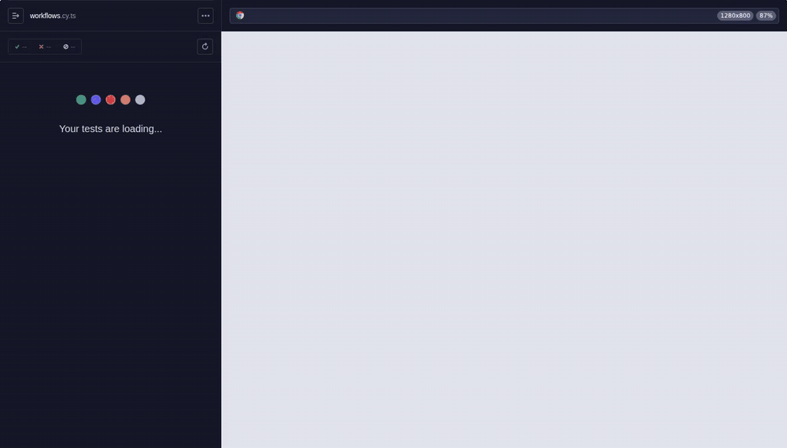

# Cypress Regression Suite

[](https://github.com/antonada/cypress-regression-suite/actions/workflows/cypress.yml)


Regression tests for **Orderly**, a small order admin app that lives in this repo. A handful of end-to-end scenarios run against the real API, and the rest of the suite uses `cy.intercept()` to make the API return exactly what a test needs: nothing at all, an error, a slow reply, or data with holes in it. Those are the states that usually break first in a real product and are the hardest to reproduce by hand.



Full quality video: [docs/media/demo.mp4](docs/media/demo.mp4)

## What the tests check

| Area                      | Tests | What's checked                                                                                              |
| ------------------------- | ----: | ----------------------------------------------------------------------------------------------------------- |
| Workflows on the real API |     6 | Sign in, filter, open an order and change its status, create an order, search, sign out                     |
| Empty states              |     6 | No orders yet, search or filter with no results, no notifications, order without items, missing fields      |
| API errors                |    13 | 500, 503, 429, network failure, broken JSON, 401, 403, 404, 422, failed save, one widget failing on its own |
| Loading and timing        |     5 | Skeleton while loading, search debounce, stale responses ignored, disabled buttons, double submit           |
| Orders list               |     8 | Paging, sorting, filters, state kept in the URL, formatting of dates, money and statuses                    |
| New order form            |    12 | Required fields, 9 invalid inputs, errors clearing, exact request payload                                   |

That's **50 tests**, run in Chrome, Firefox and Edge on every push: 150 runs in total. Each case has an ID in the [test plan](docs/TEST_PLAN.md), and the latest numbers are in the [test report](docs/TEST_REPORT.md).

## How the API responses are faked

| State on screen                | Stub                                                                         |
| ------------------------------ | ---------------------------------------------------------------------------- |
| No orders at all               | `cy.intercept(ORDERS, emptyPage())`                                          |
| Search finds nothing           | a route handler that answers empty only when `req.query.q` is set            |
| Server error, then retry works | `{ statusCode: 500 }` with `times: 1`, the retry reaches the real API        |
| Connection lost                | `{ forceNetworkError: true }`                                                |
| Slow response                  | `{ delay: 1500, fixture: 'orders/first-page.json' }`                         |
| Session expired                | `{ statusCode: 401 }`, then the user signs in and lands back on the same URL |
| Order with missing fields      | a factory-built order without customer, date or total                        |

Here's a full example. The first request fails, the user clicks "Try again", and the spy proves the app made exactly two calls:

```ts
it('shows an error on 500 and loads the list after "Try again"', () => {
  cy.intercept({ ...ORDERS, times: 1 }, { statusCode: 500, body: { error: 'Internal Server Error' } });
  cy.intercept(ORDERS).as('orders');
  cy.visit('/orders');

  cy.getByCy('orders-error').within(() => {
    cy.contains('h2', "Couldn't load orders");
    cy.contains('button', 'Try again').click();
  });

  cy.getByCy('order-row').should('have.length', 10);
  cy.get('@orders.all').should('have.length', 2);
});
```

The search box waits 400 ms after the last keystroke. Instead of sleeping, the test controls time:

```ts
cy.clock();
cy.intercept(ORDERS).as('orders');
cy.visit('/orders');
cy.wait('@orders');

cy.getByCy('search').type('maya', { delay: 0 });
cy.tick(399);
cy.get('@orders.all').should('have.length', 1);

cy.tick(1);
cy.wait('@orders').its('request.query.q').should('eq', 'maya');
```

## Running it

You need Node.js 22 or newer.

```bash
npm ci
npm run build
npm test            # starts the app on port 4173 and runs every spec headless
```

Other commands:

```bash
npm start           # just the app, then open http://localhost:4173 (admin@orderly.test / demo1234)
npm run cy:open     # Cypress app, with the server already running
npm run test:smoke  # only tests tagged @smoke
npm run lint
npm run typecheck
```

## Project layout

```
server/                 Express API with in-memory, seeded data
src/                    React app (Vite)
  lib/validation.mjs    form rules shared by the app and the server
cypress/
  e2e/                  specs, one file per area
  fixtures/             45 seeded orders, a single order, the demo user
  support/commands.ts   cy.getByCy(), cy.login() with cy.session(), cy.resetData()
  support/factories.ts  builders for one-off orders and pages
docs/                   test plan, test report, demo video
```

## Reports

Every run produces a Mochawesome HTML report per browser, with screenshots of failures embedded. Reports from `main` are published to GitHub Pages:

**https://antonada.github.io/cypress-regression-suite/**

## CI

[`cypress.yml`](.github/workflows/cypress.yml) runs lint and type checks, then the suite in Chrome, Firefox and Edge in parallel, and publishes the reports. [`record-demo.yml`](.github/workflows/record-demo.yml) is started by hand and re-records the video in `docs/media`.

## A few decisions worth explaining

- **`data-cy` attributes for selectors.** They don't change when someone restyles a button or rewrites its text. Text is still asserted, but it's not used to find elements.
- **Sign in once.** `cy.login()` gets a token through the API and caches it with `cy.session()`. A `validate` step checks the token still works, because the server forgets tokens on logout.
- **Real data where it matters.** The workflow specs reset the server to the same seed before each test and don't stub anything, so they'd catch a broken API too.
- **Shared validation.** The new order rules live in one module used by both the React form and the Express API, and both sides are tested.
- **One deliberate wait.** The stale-response test has to outlast a slow reply to prove it gets ignored. It's commented in the spec. Everything else waits on aliases or assertions.

## License

MIT
